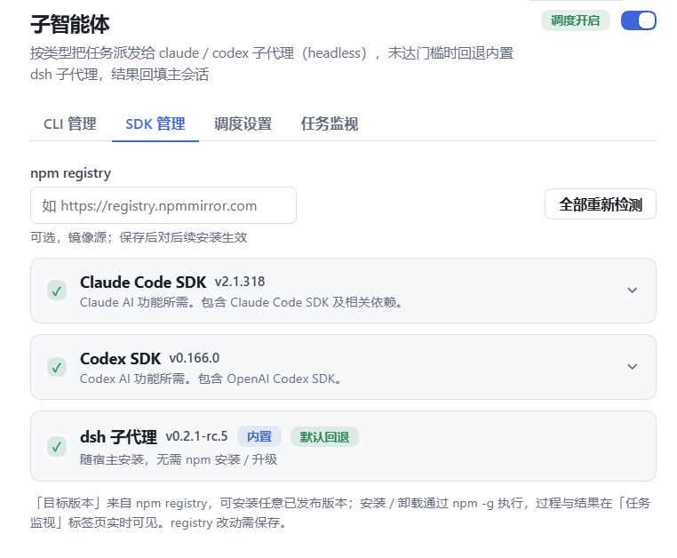
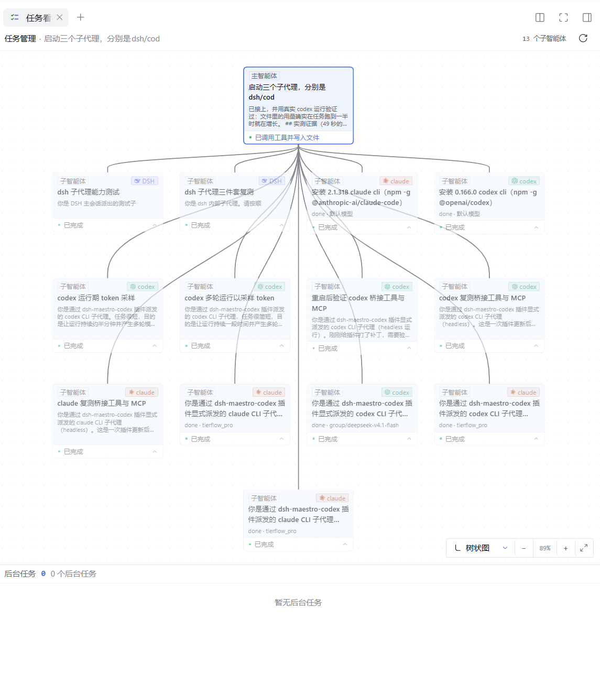

# dsh-maestro-codex

[](https://www.npmjs.com/package/dsh-maestro-codex)
[](https://github.com/GaoHu1997/dsh-maestro-codex/actions/workflows/release.yml)
[](https://github.com/GaoHu1997/dsh-maestro-codex/blob/master/LICENSE)

dsh 的 CLI 子代理编排插件：把会话中的任务按类型派发给 **codex cli**、**claude cli** 或 **grok cli**（headless）执行，取回结果回填主会话。

## 能干什么

- **按类型把任务派发给多执行器**：主会话注册 `dispatch_cli_task` 工具，主代理先判断该不该开子代理——不需要就自己完成；需要时评估难度并给出理由，达到门槛才派给 claude cli / codex cli / grok cli，未达门槛改用内置 dsh 子代理，结果自动回填主会话。
- **门槛与路由自己定**：claude / codex / grok 各自独立的最低难度（低 / 中 / 高 / 极高），互不影响；13 个内置任务类型在配置页按卡片点选分配给任一 CLI，显式指定 `cli` 也绕不过门槛。
- **CLI 装卸与权限一站式**：配置页检测版本、npm -g 安装 / 卸载 Claude Code、Codex 与 Grok CLI（`@xai-official/grok`，支持自定义 registry）；claude / grok 权限策略与 codex 沙箱档位、并发上限都在配置页设置；连续无输出超时是所有 CLI 共用的一项配置。
- **模型与思考等级沿用 dsh**：下拉直选 dsh 中已配置的供应商与模型，插件自动注入端点、密钥与协议方言并在 spawn 前做模型预检；思考等级取自所选模型自身的 `reasoningEfforts` 档位。
- **技能与工具随任务桥接**：dsh 技能目录（两段式按需加载全文）与宿主工具经随包的 `dsh_bridge` MCP 服务器交给子代理，claude 可选原生 `.claude/skills` 暂存模式。
- **执行过程全程可见**：任务监视看进度事件流、取消、超时与并发；任务看板看主智能体与全部子智能体的分层树状图；CLI 会话页回放对话、统计 Token 用量，并可直接续发消息（resume）接着跑。
- **结果与用量可追溯**：用量账本、任务结果落盘（重启后恢复最近 40 条）、幂等键去重、被杀进程恢复为「已中断」任务、健康 / 状态接口与命令行快照脚本。

## 界面预览

截图统一存放于 [docs/images](docs/images) 目录，文件名即用途。

**配置页 · CLI 管理** —— claude / codex / grok / dsh 子代理的版本、模型、思考等级、任务类型与开关：


**配置页 · SDK 管理** —— npm registry 与 Claude Code SDK / Codex SDK 的检测、安装与卸载：



**会话内任务列表** —— 派发出去的子代理带 CLI 徽标，实时显示完成状态与 Token 用量：


**CLI 子会话页** —— 任务全文与结果按气泡回放，支持续发消息接着跑，底部显示轮次、Token 用量与缓存命中率：


**任务看板** —— 分层树状图查看主智能体与每个子智能体的阶段、耗时与结果：



## 能力详解

以下按条目展开实现细节与边界。

- **dispatch 工具**：在主会话注册 `dispatch_cli_task` 工具，派发前由主代理先判断该任务是否需要开子代理——不需要就自己完成；需要时再评估任务难度并给出理由，达到配置门槛才派发，未达门槛改用 dsh 子代理（`subagent` / `subagent_fork`），不启动 CLI。
- **独立难度门槛**：在「CLI 管理」展开 Claude / Codex / Grok，各自选择低 / 中 / 高 / 极高（默认中），即时生效，互不影响；未单独设置时兼容沿用旧的统一门槛。调用工具传 `task_difficulty`（`low / medium / high / extreme`）与 `difficulty_reason`，按实际选定 CLI 的门槛校验，不改选门槛更低的 CLI 绕过限制。旧调用未评估按低处理，显式指定 `cli` 也不能绕过门槛。低：问答、查询、局部编辑；中：常规多步骤任务；高：跨模块重构、复杂调试；极高：系统级设计或迁移。难度由主代理评估，类型关键词只负责选择 CLI，不抬高任务难度。
- **路由表**：配置页以卡片点选为每个 CLI 配置任务类型与默认 CLI；内置任务统一为 13 个四字名称，悬停查看具体工作与交付要求。Claude 默认选择仓库探索、影响分析、模块重构、方案设计、文档整理；Codex 默认选择功能开发、缺陷修复、测试验证、代码审查、数据处理。代码定位、资料检索、方案核验同样可手动分配给任一 CLI，本版不新增 DSH 管理配置。旧内置名称自动映射为新名称并保留旧关键词路由兼容，不覆盖用户已有分工或自定义类型。
- **技能 / 工具桥（dsh_bridge）**：派发时把 dsh 的技能与宿主工具一起交给 CLI 子代理，来源都是 dsh 本体，没有第二套配置。**技能**：dsh 技能目录（名称 + 摘要）注入任务开头，全文经随包分发的 `dsh_bridge` stdio MCP 服务器（`skill_<name>` 工具）按需加载——与 dsh 主会话自己的两段式技能体验对齐；只暴露「模型可调用」的技能，`disable-model-invocation` 与 `*.disabled` 在主会话不可见的这里同样不可见。claude 另可选**原生模式**（`claudeSkillsMode: native`）：把技能暂存成临时 `.claude/skills` 树以 `--add-dir` 挂上，由 claude 自带的 Skill 工具与 `/技能名` 加载，frontmatter 的 `whenToUse` 会改写为 claude 认的 `when_to_use`；暂存失败自动回退桥模式。**宿主工具**：`ctx.tools` 注册表按四种模式桥接（`bridgeTools: off / auto / scoped / custom`）。auto 用内置排除表滤掉 shell/文件/会话/编排类（含 `ops_*`；不能假设宿主文件工具自动可用）；scoped 是「子代理需要改文件」的最小放行面：12 个 `ops_` 文件工具白名单与当前 agent 可见工具取交集，按真实 schema 将路径（包括省略的搜索根）绑定为任务 cwd 下的绝对路径，边界检查与执行使用同一组参数；越界或无有效 cwd 返回 403，缺必需路径或参数形状错误返回 400，`ops_bash`、`ops_discover_tools`、`ops_result` 不在名单中；令牌模式/白名单冻结为权限上限，改全局配置不会拓宽旧 scoped 令牌；custom 按精确名单；http 传输的 MCP 工具只能经 custom 名单到达子代理。桥接调用仅在具备可信代理和真实工具 scope 时走 dsh 的完整工具流水线（pre-execute → guard → dispatch → post）；缺少该宿主 seam 时明确拒绝宿主工具调用，技能桥仍独立可用。每次派发签发一次性 token，任务结算即作废并中止进行中的桥接调用。权限、会话能力与宿主限制详见 [CLI 安全说明](docs/cli-safety.md)。放在 `.agents/skills`（项目或 `~/.agents/skills`）的技能，codex 子代理不经桥也能原生读到——两个体系对这套目录天然共享。
- **权限配置**：claude 支持 `default / acceptEdits / plan / bypassPermissions`（`继承` = 使用 CLI 非交互默认策略）；codex 通过沙箱（`read-only / workspace-write / danger-full-access`）划界。API 地址、Token、CLI 路径收在「高级连接设置」里，默认折叠；连续无输出超时不用按 CLI 各设一份，统一在「调度设置」配置。
- **模型配置（dsh 目录直选）**：配置页的「dsh 模型」下拉直接列出 dsh 中已配置的供应商与模型（读取 llm-pi-ai 设置 + credentials 密钥）。选中后插件自动把端点/密钥/模型注入 CLI——codex 经 `-c` 合成 model_provider（OpenAI 兼容供应商，`openai-responses` 与 `openai-completions` 都可选，统一按 responses 方言驱动；codex 0.146+ 已移除 chat 支持），claude 经 ANTHROPIC_BASE_URL/AUTH_TOKEN（仅 anthropic-messages 协议），并把同一组变量写进一次性的 `--settings` 文件——Claude Code 会用它自己 settings 文件里的 `env` 块覆盖进程环境变量；只设进程 env 时，用户 `~/.claude/settings.json` 里残留的网关会静默顶替配置页的选择（旧网关失效时整轮任务直接 403）。**默认沿用主代理当前选择的模型**（协议不支持该 CLI 时改用配置页的选择）；工具参数显式指定 `provider::model` 时锁定该 DSH 供应商；裸模型名也只能在主代理或配置页的可信 DSH 供应商上解析和预检，不能绕过端点校验。两者都拿不到可用端点时任务**直接失败并列出原因**（例如主代理是 anthropic-messages 协议却派给 codex + 配置页没选模型），不会回落到 CLI 自身配置文件里的模型——那是另一套供应商与密钥。codex 在注入 dsh 端点时以 `--ignore-user-config` 运行，用户自己的 `~/.codex/config.toml`（自带 model/model_provider、`model_instructions_file`、notify、插件与 MCP 服务器）不再参与派发的任务；被一起甩掉的 `[windows] sandbox` 由插件补回（Windows 上重新声明 `windows.sandbox="elevated"`，否则 codex 会拒绝执行任何命令，子代理连文件都读不到）。真正 spawn 之前还有一道**模型预检**：协议不匹配的候选直接跳过；端点不接受该模型名时（供应商没声明这个模型，或探针返回 404）当场报出是哪家供应商、哪个模型，不再让 CLI 跑到一半才失败；预检只是 1-token 的最小请求，连不通时记为「无法判定」仍然照常派发。
- **思考等级**：档位**来自所选 dsh 模型自身配置的 `reasoningEfforts`**（llm-pi-ai 模型条目），不写死——选了模型，思考等级下拉就列该模型声明的档位（如 off / low / medium / high）；未选模型或模型未声明时只能保持默认。claude 经 `MAX_THINKING_TOKENS` 传参（off/none→0，low/medium/high→4k/10k/32k，未映射的档位忽略）；codex 经 `-c model_reasoning_effort` 原样传参（codex 不认的档位如 off 自动跳过），与「-c 覆盖项」同时设置时覆盖项优先。
- **CLI 管理**：配置页检测版本、按版本安装/卸载（npm -g：`@anthropic-ai/claude-code`、`@openai/codex`、`@xai-official/grok`），版本列表只列正式版并标注当前平台，支持自定义 registry。
- **任务监视**：只记录 `dispatch_cli_task` 派发的子代理任务（带 CLI 徽标，与主会话自己执行的工作区分开）；进度事件流、取消、超时（claude / codex / grok 共用一项配置）、并发上限。
- **任务看板**：装了 [dsh-better-sidebar](https://github.com/omdsh-dev/DSH-better-sidebar) 时，右侧栏多一个「任务看板」tab。直接移植该项目 **0.28.2 原版任务管理**：真实分层图、SVG 曲线、点阵背景、缩放/拖动/适配、图/树切换、两段式卡片、自动折叠、原版详情浮层与后台任务抽屉，源码与 CSS 有逐字节/等价测试。仅在数据桥接层加入 CLI 子代理：按所属会话挂接、外部目录去重、阶段/耗时/Token/转录/取消，继续使用既有路由；不再使用旧的纵向缩进图与额外筛选栏。页头 CLI chip 与 `maestroCliUsage` 继续提供统一入口和统计；会话接口现由可信宿主 capability 授权，sessions 只能收窄，后台作业输出游标语义保留。详见 [任务板说明](docs/task-board.md)。
- **CLI 会话页**：CLI 子代理可建立 one-shot DSH 记录镜像（不是普通 DSH 执行器对话）。任务详情和顶部入口优先打开右侧 CLI 对话页，宿主缺少右栏 seam 时才回落覆盖层；观感对齐 DSH 的会话窗口：任务全文是右侧的用户气泡，CLI 的流式回答是左侧气泡，工具调用与阶段折成细窄的系统行，多轮回复按 `replyTo` 串成一整段对话。底部输入框可以直接**续发消息**——走 `POST /task/reply` 起一个带 `resume`（claude `--resume` / codex `exec resume` / grok `-r`）的新回复任务，原任务的难度门槛与 CLI 路由原样沿用；链尾失败/超时没拿到会话引用时自动退回最近一个可续接的轮次，同一会话同时只允许一条回复在跑（发送后到列表刷新前输入框锁定，服务端再兜一层 409）；续发默认继承上一轮 DSH 模型与思考配置；服务端支持显式 DSH 模型选择（按 CLI 协议过滤），绝不读 CLI 自身配置。页面必须持有当前父会话的宿主能力；地址 scope 不授权，原 CLI 禁用时拒绝而不换执行器。
- **用量与请求记录**：调用开始先在 `$DSH_HOME/maestro/usage-journal` 写 canonical pending 标记，结束后保存不可变结算记录；成功、失败、取消和超时均保留实际已采集消耗。`maestroCliUsage` 是从该权威账本恢复的父会话显示投影，**不再追加私有 `maestro/cli-usage` 事件到严格会话日志**。累计及幂等身份独立于 recent 窗口；未知桶保持 null，`knownTotals` 仅为已知小计。公开 `maestroCliAccounting.read/settlements` 服务要求父会话的宿主能力，单独 sessionId 不授权。可选标准子记录镜像使用相同 usageId 与父子归属；消费者不可将父自定义投影与标准子记录相加，也不能把 CLI 消耗算作父主模型的调用。Codex 的 inclusive input 同时扣除缓存读和缓存写；resume 在进程启动前捕获线程累计基线，只计当轮增量。stdout 与 rollout 在原始计数层合并，避免二次计算缓存写；基线缺失或回退时明确降级，不把历史或缺失值当成本轮零消耗。用量展示成功不代表宿主标准重放或每个统计插件已验证，必须按真实版本逐层对账。历史错误账务不随代码升级自动改写；严格日志兼容与离线恢复见 [历史恢复说明](<docs/session-history-recovery-guide.md>)。
- **任务结果落盘**：每次派发结算后，把任务摘要、最终文本与事件尾（最近 200 条）写入 `$DSH_HOME/maestro/tasks/<taskId>.json`（最多保留 200 条，可在「调度设置」关闭）。插件启动时把最近 40 条读回来种进任务表——重启后「任务监视」仍能翻看历史结果与转录。
- **可靠性面**：派发前把 `launch` 行落进 `$DSH_HOME/maestro/effects.json`（同键覆盖、5s→300s 退避、三连败进健康面板），任务到终态即结算；进程被杀留下的行在下次启动时变成 **`interrupted` 任务**（终态但不算失败，阶段显示「已中断」，等你决定是否重派）。同一父会话 + CLI + 任务名 + cwd 在 10 分钟内重复派发会被幂等键挡下（`dedupe_key` 可显式指定，续接不参与）。派发末尾提示 CLI 用一行 `MAESTRO_RESULT {"state","human_action","summary"}` 交代收尾，读不到就当没说、绝不从自由文本里猜。新增 `GET /health`（七个单写者健康条目）、`GET /status`（阶段计数 + 待处理副作用）、`GET /prompts` + `POST /prompts/save`（可改写提示模板，默认变动后标 `stale`）、`GET /config-history`（脱敏后的配置变更历史）。阶段派生 `stage = person/answer · person/review · person/blocked · person/failed · working/queued · working · idle`，看板据此显示「等你回话 / 等你验收」。命令行看快照：`node scripts/maestro-status.mjs [--json]`。详见 [可靠性面](docs/reliability.md)。
- **会话续接（resume）**：工具支持 `resume` 参数，传上次结果里的 sessionRef（Claude session id / Codex thread id / Grok session id），通过真实 CLI resume 保留记忆，不自动继承父会话上下文。成功或失败的已创建任务均返回 taskId、phase；取得 sessionRef 后即使失败也保留它，失败结果仍明确 `ok:false`，不把错误变成成功。引用必须归属当前可信父会话，续接生成 replyTo 链并固定原 CLI/cwd，同一真实会话链只允许一个并发续接。前置参数、难度、权限或归属拒绝仍直接报错，不创建可续接的假任务。
- **宿主能力与版本检测**：插件只通过公开服务适配宿主，不同 dsh 版本暴露的成员并不一致。每次读概况（`GET /overview`）都会带一份 `hostCapabilities` 报告：逐个列出 `settings / skills / agents / sessions / sessionQuery / sessionPersistence / sessionProjections / tools / systemPrompt / webServer` 是否解析成功、缺哪些成员（`degraded: none | partial | absent`）、缺失时的实际影响，另附 `@deepseek-ai/dsh-session`、`dsh-scope`、`dsh-host-webserver`、`dsh-settings`、`cordis` 的真实版本号（读不到为 `null`，不编造）。报告同时给出 `permissionContext`：宿主工具的可信上下文来自 `agents.get` 返回的真实 Agent、转发的是宿主自己的 symbol parent token，且**地址里的 scope 参数从不参与授权**。这份报告只做观测：不调用宿主、不改宿主、不读取私有状态，也不因为某项缺失而放宽任何权限——缺失的 `sessions`/`sessionProjections` 只会让原生镜像与公开投影按前述规则 fail closed。
- **拓扑可见，不进后台任务**：启用原生记录且宿主支持时，派发为 CLI 创建真实 `cli-<taskId>` 子记录，并追加符合宿主 schema 的 `mode: 'one-shot'` 目录行；不再写 `mode: external`。新子记录携带 `maestro/cli-child` 元数据（含 `taskId` 等身份字段，不含任务名）。注意：当前宿主 0.2.2-rc.1 的持久化 writer 不写 `session/title`（已知类型即使带 `ignorable` 也被跳过，插件侧也没有标题 API），因此统计插件看到的是 `cli-task-...`——这是宿主标题服务的限制，不是插件的配置项；旧记录可由统计插件读取实际父会话的目录标签兼容，无须改写历史日志。顶部统一入口与看板将镜像和 CLI 任务去重。记录只提供查看和标准统计，不能交给普通 DSH 执行器回复；续接只走 Maestro 的原 CLI 工具或页面入口。CLI 任务不登记到宿主后台 jobs，避免同一任务出现两份状态与取消入口。
- **派发上下文与韧性**：派发前可自动把 cwd 的 git 工作区快照（分支/未提交改动，只读）拼进任务开头（`injectGitContext`，默认开）；CLI 超时指连续无 stdout/stderr 非空输出分片的时长（`timeout_minutes`，1–240 分钟，不是总运行时长；配置页只有一项「连续无输出超时」，claude / codex / grok 共用——旧配置里的 `claudeTimeoutMinutes` / `codexTimeoutMinutes` 仍会被读取，两者不同时取较大值迁移到统一项），每个真实输出分片重置计时；这是无输出保护，不判断任务语义进展。无输出窗口剩余约 1/5（至多 2 分钟）时在事件流预警，恢复输出也重置预警；版本检测、npm 等一般进程仍按总时长超时；普通失败可配置自动重试（`failureRetries`，0–2，默认 0——会改文件的任务建议保持 0，超时与手动取消永不重试）。前置准备可用 `prepareCommand`（默认空，≤4000 字符）：在任务 cwd 里先跑一次（例如 `git worktree add`），失败则本轮 `failed` 且不启动 CLI。

## 执行方式

- claude：`claude -p --output-format stream-json --verbose`，任务文本走 stdin；`resume` 时追加 `--resume <sessionId>`。
- codex：`codex exec --json --skip-git-repo-check --ignore-user-config -`，任务文本走 stdin；`resume` 时为 `codex exec resume <threadId> --json …`，续接指令同样走 stdin。
- grok：`grok -p - --output-format streaming-messages-json`，任务文本走 stdin；模型/密钥/端点经 `XAI_API_KEY` 与 `GROK_XAI_API_BASE_URL` 注入，思考等级走 `--reasoning-effort`，dsh_bridge MCP 服务器写进 maestro 专属的 `GROK_HOME` config.toml（隔离操作员自己的 `~/.grok` 配置，会话持久化在该目录以支持 resume）；`resume` 时追加 `-r <sessionId>`；共享 home 的任务从写配置到 CLI 退出按顺序执行（等待可取消），跨宿主使用独占运行租约，避免不同任务的桥接配置串用；每个 stdio MCP 子进程（包括未声明 env 的服务器）都清除继承的模型凭据，仅还原该服务器显式声明的环境。异常退出遗留租约的处理见 [CLI 安全说明](<docs/cli-safety.md#mcp-子进程环境与-grok-共享目录>)。

## 安装包内容与入口

安装包只交付编译后的 [lib](<lib>)、补丁/许可/图标/语言资源、本页链接的用户说明与 [状态脚本](<scripts/maestro-status.mjs>)；不包含源码、开发构建脚本或历史测试/修复证据。运行状态脚本请先进入实际插件安装目录，或把命令中的路径改成该脚本的绝对路径。它只依赖与插件相同的 Node（`>=22.19`，内置 `fetch`），无需补装其他脚本。

主入口仍为 [lib/index.js](<lib/index.js>)，声明为 [lib/index.d.ts](<lib/index.d.ts>)。`dsh-maestro-codex/client` 的声明由真实 [客户端入口](https://github.com/GaoHu1997/dsh-maestro-codex/blob/master/src/client/index.ts) 生成到 [lib/client.d.cts](<lib/client.d.cts>)；对应 [lib/client.js](<lib/client.js>) 是交给 DSH Web `__ModuleLoader__` 的 CJS factory，不是独立 Node 命令或可在 Node 直接执行的浏览器模块。下列开发命令只在源码仓库使用；安装包的运行桥是 [lib/bridge-shim.js](<lib/bridge-shim.js>)，不需要开发期 `build-upstream` 脚本。

## 版本日志

### 1.0.0

- **正式版验收修复**：Windows 上精确识别本地/全局 npm Codex 与 Grok shim，直接 Node 启动时保持 JSON/TOML、中文路径、空字符串和 shell 元字符的逐字节 argv；自定义 launcher 的 hook 与参数保持原语义，不猜另一布局的入口。
- **Grok 桥接安全隔离**：所有 stdio MCP 服务器均清除继承的供应商密钥及其他服务器 token，只恢复自己的显式 env；共享会话目录使用可取消顺序队列和跨进程运行租约，保持原生 resume 并防止配置串用。
- **模型预检分类修复**：按结构化错误类型与参数区分「模型不存在」和「请求参数不支持」，避免 `max_tokens` / `max_completion_tokens` 差异把有效模型误判为不可用；鉴权和明确模型缺失仍拒绝。
- **回归测试稳定性**：限制 Vitest 并行 worker，仅为真实 Node/Bash/PowerShell 集成用例设置与进程期限匹配的有限预算，保留全部安全断言和纯单测默认超时；补充 Windows 启动、MCP 真实子进程及 Grok 并发/取消/租约/续接回归。

### 0.1.16

- **宿主工具桥新增 `scoped` 模式（子代理可改文件的最小放行面）**：`bridgeTools` 在 off / auto / custom 之外新增 scoped——固定放行 12 个 `ops_` 文件工具（读/写/编辑/复制/移动/删除），且只桥接宿主对当前父代理实际公开的交集；`ops_bash`、`ops_discover_tools`、`ops_result` 永不放行。每次调用把路径（含省略的搜索根）绑定为任务 cwd 下的绝对路径，词法与 realpath 边界检查和执行转发同一组参数；越界或无有效 cwd 返回 403，缺必需路径或参数形状错误返回 400。令牌签发时冻结模式与白名单上限，改全局配置不会拓宽旧令牌。

- **派发日志交代 scoped 实际可见面**：派发时列出实际可见与缺失的文件工具名单，缺工具时提示主代理先在宿主按需选择并确认可见再重新派发，不承诺目录会自动扩张，也不要改用 shell 绕过。

- **提示词与文档对齐**：路由提示词改为「宿主工具只在配置页放行时才到子代理手里」（auto 不含 ops_*/job_*/schedule_*/shell/文件类）；`docs/cli-safety.md` 新增 scoped 边界、路径适配与升级前置条件（旧版 0.1.14 不认识 scoped，直接写配置会导致插件加载失败，必须先装含 scoped 的构建再选模式）。

- **修复**：`scripts/repair-cli-session-logs.mjs` 的 `--apply` 与 `--dry-run` 现在互斥（同时传报 `INVALID_ARGUMENTS`）。


- **CLI 重连恢复期限**：Codex 的持续 `Reconnecting`（以及 Claude / Grok 的重连、重试与网络错误诊断）不再无限刷新无输出保护——首次诊断起算同长度恢复期限，重复诊断不续期，识别到真实协议帧即解除；到期请求终止进程并记 `reconnectTimedOut`，不误报为用户取消或任务超时。

- **进程收尾有界化**：子进程 `exit` 后最多保留 5 秒读取管道尾部；超时/取消后 6 秒收尾期限届满仍未 `close` 时刷新尾行、关闭管道并明确报「进程终止或输出完整性未确认」，不再对已退出进程盲杀，也不会因继承的 stdio 永久挂起。

- **宿主侧等待 deadline**：新增 `src/deadline.ts`（`awaitWithin`）；dsh_bridge 技能发现/读取 20s、宿主工具 10 分钟、垫片单请求 15 分钟，派发记账/结算/清理 30s、取消冲洗 5s，Grok 运行前文件系统步骤 30s，Claude 设置清理 5s——忽略 AbortSignal 的宿主实现不再让工具调用永远挂起。

- **Grok 共享目录隔离**：`$DSH_HOME/maestro/grok-home` 同目录派发从写配置到 CLI 退出全程串行（可取消、不改写运行中配置），跨宿主进程用 `.maestro-run.lock` 文件租约拒绝竞争；异常遗留租约保守拒绝并给出清理指引。

- **模型预检收紧**：探针只在结构化错误码（`model_not_found` 等）或明确「模型不存在」措辞时拦截派发；参数/上下文/配额/限流类错误降级为提示照常派发，不再因 1-token 探针误判阻断任务。

- **错误响应脱敏**：模型目录与设置描述接口失败时返回通用文案，不再把可能含凭据的 provider/MCP 错误透传给客户端；mcp-env-shim 清除继承的模型凭据/端点环境变量，显式声明同名变量视为操作员授权。

- **看板与用量修正**：中断任务在看板显示「已中断」第五状态词（upstream 状态槽位适配，含 source-manifest 同步）；用量统计改名「近 7 天可见样本」并区分「feed 不可用」与「零调用」，不再误报；`maestro-status.mjs` 校验 HTTP 200 之外的完整状态形状。


- **看板嵌套折叠组展开修复**：外层折叠组摊开时，成员里若还有内层折叠组（如「已完成 N」下再套「已完成 N」），现在会在同一次渲染里递归解析，内层点击立即生效；此前外层每次展开都把未解析的成员原样塞回 children，内层的展开状态永远轮不到，点了没反应。附嵌套折叠组展开/保留回归测试。

- **grok 品牌视觉更新**：执行器标识改用 xAI 官方 logo（斜杠双翼图形），配色由紫色改为中性灰（light/dark 双色），任务列表、看板徽标与用量表同步。

### 0.1.13

- **新增 grok cli 执行器**：支持把任务派发给 xAI 官方 Grok Build CLI（`@xai-official/grok`，headless `grok -p - --output-format streaming-messages-json`）。该输出与 claude stream-json 同构（Anthropic Messages wire），帧解析复用 claude 通道；错误帧退出码可为 0，按帧判定成败。模型/密钥/端点经 `XAI_API_KEY` 与 `GROK_XAI_API_BASE_URL` 注入，思考等级走 `--reasoning-effort`（档位不认时跳过并提示），`resume` 用 `-r <sessionId>`。
- **派发隔离与配置**：每次派发写入 maestro 专属 `GROK_HOME`（`$DSH_HOME/maestro/grok-home`）的 config.toml，只含当前桥接的 dsh MCP 服务器——密钥不落盘，经 mcp-env-shim 从子进程环境还原（与 codex 同款 `MAESTRO_MCP_SECRET_*` 别名），并 `--allow mcp__<server>` 预授权；操作员自己的 `~/.grok` 配置不参与派发，会话持久化在专属 home 以支持跨运行续接。配置页新增 grok 卡片（开关、任务类型、最低难度、权限模式、dsh 模型、思考等级、连接设置），默认关闭，不影响现有路由。
- **路由泛化**：`cli` 参数与 auto 路由支持 `grok`；被点名 CLI 停用时回落到默认 CLI（启用时），否则任一启用 CLI，不再假设只有两个 CLI。协议闸门对 grok 只放行 OpenAI 兼容端点，预检按 chat completions 方言探测（grok 实际上游），端点声明 responses 也照此改写。
- **Windows 启动修复**：npm 安装的 grok.cmd shim 与 codex 同样经 cmd.exe 转发 `%*` 破坏引号，识别后改 node 直启 `@xai-official/grok/bin/grok`（兄弟 node.exe 优先、PATH 回退）；`prepareCommand` 在 Windows 上改用 verbatim 引号包裹，`node -e "process.exit(3)"` 这类含引号命令的退出码不再被静默吞成 0。
- **杂项**：npm 安装遇 EBADPLATFORM 时提示换官方 registry 重试（镜像 dist-tags 可能过期）；看板与任务列表增加 grok 品牌色与徽标；locale 与 SDK 卡片同步 grok 文案。

### 0.1.12

- **设置导航图标**：左侧菜单「子智能体」设置项经宿主 `settings.section.icon` slot 换成层级树图标（一个主节点统领两个子节点），替换默认齿轮；线稿风格跟随菜单文字色，激活态自动变色。
- **CLI 管理页排序与品牌标**：dsh 子代理行排到 claude / codex 之前；安装行的 ✓/· 状态圆点替换为各执行器的品牌图标，与看板视觉一致。
- **用量统计重做**：任务监视页顶部的用量面板从 token 明细 + 7 日柱状图改为每个 CLI 一行的「调用 / 成功 / 失败 / 成功率」表，配双色比例条；token 桶明细与「有限可见样本」提示移除，统计口径不变。

### 0.1.11

- **Windows Codex 启动修复**：npm 安装的 codex.cmd shim 经 cmd.exe 转发 `%*` 会二次解析参数，破坏含 JSON 的 TOML override 引号（MCP 服务器配置、`-c` 覆盖项含空格/引号时启动失败）。现在识别 npm 生成的 shim 后改为直接用 node + codex.js 启动——优先 shim 同级的 node.exe，否则回退 PATH 上的 node，绝不使用桌面宿主的 Electron 可执行文件；自定义批处理 launcher 保持原 cmd 路径语义不变。
- **引号保真回归测试**：新增 Windows 启动计划测试，覆盖 npm shim 识别、兄弟 node 回退、自定义 launcher 直通，以及真实子进程下 MCP TOML/JSON 与 shell 元字符的逐字节保真。

### 0.1.10

- **统一超时配置**：连续无输出超时改为 claude / codex 共用一项 `timeoutMinutes` 配置；旧配置里的按 CLI 超时仍会被读取，两者不同时取较大值迁移，配置页不再各设一份。
- **Codex MCP 密钥不再进入 TOML / argv**：桥接服务器的 env 值改经进程环境别名（`MAESTRO_MCP_SECRET_*`）+ 随包 shim 还原注入，命令行与生成配置里不再出现明文密钥。
- **子会话镜像补全生命周期**：原生 CLI 镜像补齐 `turn/start` / `step/end` / `turn/end` 事件与真实终态原因（完成 / 错误 / 超时 / 取消 / 中断）；结算 append 失败进入重试队列，由 `flushPending` 续投。标题只在语义层保留 `session/title` 事件，当前宿主不落盘（见上文说明）。
- **旧 CLI 日志迁移工具**：新增 `scripts/repair-cli-session-logs.mjs`，把旧的 4 事件镜像严格迁移到补全生命周期的格式——默认 dry-run，`--apply` 需原文件 SHA-256 校验，逐字节备份并原子替换，未知形态拒绝写入。
- **用量面板口径修正**：未知 / 负值 token 显示为「未知」（null）而不是 0，已知小计单独保留；默认统计窗口改为今天及前 6 个本地自然日。
- **文档与测试**：历史恢复指南收录迁移工具用法与安全边界；新增恢复工具、MCP env shim、会话产物运行时与恢复超时等测试。

### 0.1.9

- **会话授权与续接链隔离**：投影注册改为独立 capability lease，注册失败、卸载或宿主清理异常时撤销本安装发放的授权；task 子会话只能访问同一 owner、同一 CLI 的真实续接分支，兄弟分支和其他 owner 仍拒绝。续接视图元数据有界持久化，支持任务裁剪与重启恢复。
- **失败原因更易读**：任务详情与 CLI 会话将原始错误归纳为取消、超时、限流、网络、退出码或无结果等短提示，并可展开查看清洗后的完整错误。
- **用量与任务监视优化**：用量面板新增近 7 天每日成功/失败调用图；任务监视默认保留所有运行中任务及最近 8 个已结束任务，可展开完整列表。
- **配置页整理**：连续无输出超时移至调度设置，缩短桥接说明并移除已过时的高级连接设置折叠区。
- **安全测试夹具**：测试临时目录使用带所有权校验的清理工具，避免沿符号链接/Windows reparse point 清理到夹具外；会话日志修复测试分别覆盖路径链接与硬链接拒绝。
- **文档与界面预览**：重整 README 功能介绍并加入配置、任务看板与 CLI 会话截图；补充续接授权边界及 npm 已发布但 GitHub Release 资产恢复说明。

### 0.1.8

- **后台任务面板常驻底部**：即使没有可显示的后台任务，也保留固定底部抽屉并展示中英空态提示；通过自动上边距保证在看板空态、错误提示等布局下仍贴底。
- **忽略本地验证产物**：将独立验证副本与会话修复扫描生成文件加入 `.gitignore`，减少误提交风险。

### 0.1.7

- **修复历史加载失败**：移除会破坏严格 session log 的私有用量事件追加；实时数据留在任务板，持久用量账本仍为权威。
- **离线修复工具覆盖旧事件**：历史恢复工具能处理旧的私有用量事件。
- **限制 CLI 子会话任务访问**：子会话仅能访问其所属任务，拒绝其他会话越权。
- **会话页统计与视觉统一**：CLI 徽标和底部用量统计对齐宿主样式，去除重复状态信息。

### 0.1.6

- **CLI 会话页体验**：重做续接输入区，补充状态、错误提示、窄栏适配与 token 用量统计。
- **发布流程保护**：只有实际推送 `v*` tag 才执行 npm 发布和 GitHub Release；手动 workflow 仅验证。
- **测试与构建稳定性**：升级 Vitest 4/OXC 配置、隔离测试 mock，并增强 Windows 子进程测试超时保护。

### 0.1.5

- **技能 / 工具桥（dsh_bridge）**：将 dsh 技能目录与宿主工具桥接给 CLI 子代理，Claude 可选原生技能目录模式。
- **可靠性与账本**：新增副作用队列、任务恢复、幂等去重与权威用量账本。
- **原生会话镜像、模型与续接强化**：补充宿主能力报告、运维接口、状态脚本及会话历史修复工具。

## 开发

```bash
pnpm install
pnpm build      # clean lib → tsc（host）→ tsdown（client.js + client.d.cts）
pnpm test       # vitest
```

安装到 dsh：在 dsh 插件市场或插件管理器安装本包；`cordis.patch.yml` 会把 `dsh-maestro-codex` 条目插入 profile。

## 参考

设计调研了 [jetbrains-cc-gui](https://github.com/zhukunpenglinyutong/jetbrains-cc-gui) 的 ai-bridge 多 CLI 通道抽象（claude stream-json / codex app-server）。
